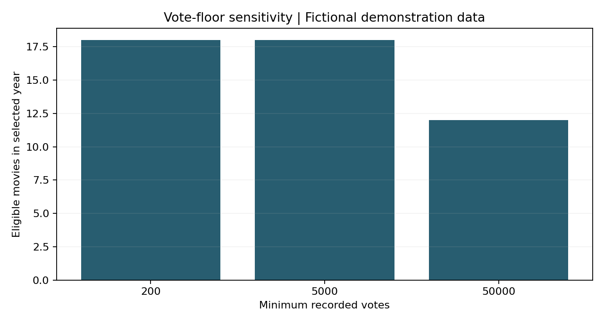

# IMDb Catalogue Analytics

**Grace Ngo | SQL, SQLite and Python**

How do genre definitions, missing metadata and vote thresholds change the patterns an analyst sees in a film catalogue?

This project turns three relational queries into an auditable catalogue-review workflow: runtime-bin rating summaries, genre coverage by release decade, and year-specific shortlists with vote-floor sensitivity. SQL handles joins, grouping, genre membership and deterministic ranking. Python validates inputs, presents compact results and tests the decisions behind them.

The analytical use is catalogue exploration and shortlist review. Ratings are recorded audience evaluations, votes are participation counts, and genre presence describes catalogue coverage. These measures do not establish viewing figures, commercial demand or an optimal film runtime.

## Evidence and reproducibility

The original analysis used a local `imdb.db` file. That database was not included with the supplied notebooks. Corrected original-database findings therefore have not been reproduced. The published example outputs use **41 explicitly fictional titles** to demonstrate and test the workflow; they are not an IMDb sample or a reconstruction of its results.

Two supported paths make the project executable:

- Run the self-contained fictional demonstration without a database or network connection.
- Analyze an authorized local database, or build a local movie subset from IMDb's official TSV files. Real data and generated local results stay outside Git.

## Analytical outputs

| Output | Question | Important definition |
| --- | --- | --- |
| Runtime summaries | How do mean title ratings vary across supported runtime bins within a genre? | Explicit `AVG(rating)` and title counts; at least two qualifying titles per bin by default |
| Genre coverage | What fraction of eligible catalogue movies carries each genre tag in a release decade? | Exact tokens; multi-genre membership; all eligible movies form the denominator, including unknown genres |
| Year shortlist | Which eligible movies have the highest recorded ratings? | Rating descending, votes descending, title ID ascending for stable ties |
| Vote-floor sensitivity | How much does the eligible pool and shortlist change when minimum votes increase? | Eligible counts, baseline retention and Jaccard overlap |
| Data profile | Which records can support each question? | Full-table counts and explicit missing markers, rather than the first 50,000 rows treated as a random sample |

Adult titles and television entries are consistently excluded. Runtime intervals are half-open: `[40, 200)` excludes 200, and a bin beginning at 90 covers 90–99.999 minutes. Genre shares can sum above 100% because films may have multiple genres. A decade with no eligible movies has an undefined share, not an observed zero percent.

## Run the demonstration

Python 3.11 or later. From the repository root:

```sh
python -m venv .venv
source .venv/bin/activate
python -m pip install -r requirements.txt
python -m imdb_analytics.analysis --demo
python -m unittest discover -s tests -v
```

On Windows, activate with `.venv\Scripts\activate`.

[Demonstration outputs](reports/demo) include CSV tables, a JSON summary and two charts. Every summary identifies the dataset as a synthetic fixture. The [analysis notebook](Analyzing.ipynb) executes the same package, and [Exploring Data.ipynb](Exploring%20Data.ipynb) demonstrates the profile and schema checks. Their code cells were executed sequentially; native Jupyter kernel launch was not verified in the publication environment.



## Use a local database

```sh
python -m imdb_analytics.analysis --database data/imdb.db --year 2010 --output outputs/local
```

The database opens read-only. A missing path raises an error instead of silently creating an empty SQLite file. Required columns are checked, and duplicate title IDs stop the workflow before they can multiply joined rows.

| Table | Required fields |
| --- | --- |
| `titles` | `title_id`, `type`, `primary_title`, `is_adult`, `premiered`, `runtime_minutes`, `genres` |
| `ratings` | `title_id`, `rating`, `votes` |

The schema matches the supplied exploration notebook's relevant tables. Additional tables are permitted but are not required or claimed as part of this implementation.

### Import official TSV files locally

Obtain `title.basics.tsv.gz` and `title.ratings.tsv.gz` through [IMDb's official documentation](https://www.imdb.com/interfaces/), subject to its terms. Then run:

```sh
python -m imdb_analytics.importer \
  --basics data/title.basics.tsv.gz \
  --ratings data/title.ratings.tsv.gz \
  --output data/imdb_movies.db
python -m imdb_analytics.analysis --database data/imdb_movies.db --output outputs/local
```

The streaming importer retains non-adult movies, converts `\N` to null, records source hashes and creates a year-filter index. It refuses an existing destination and removes incomplete output after failure. This produces a new local subset, not the absent historical database. Snapshot differences must be considered before comparing runs.

## Verification

**Sixteen automated tests** cover numerical aggregation, bin boundaries, exact genre membership, join cardinality, multi-genre denominators, consistent title eligibility, stable ranking ties, empty results, parameter binding, missing files, read-only behavior and atomic imports. The full fictional demonstration also runs in GitHub Actions.

The corrected runtime query explicitly averages title ratings. The original query selected unaggregated rating and runtime columns while grouping by runtime bin, so its values did not establish the average-rating curves described in the original report. [The methodological review](docs/methodology.md) records this and other changes.

## Repository structure

```text
imdb_analytics/
  analysis.py        Validation, profiling, query wrappers and figures
  importer.py        Streaming local TSV importer
  fixture.py         Fictional verification records
  queries/           Inspectable parameterized SQL
tests/               Numerical and behavioral checks
reports/demo/        Fictional demonstration outputs only
docs/                Methodological decisions and source fingerprints
Analyzing.ipynb      Executed analytical walkthrough
Exploring Data.ipynb Executed schema and data-quality walkthrough
Data Report.ipynb    Concise interpretation guide
```

## Authorship, source and limits

The original notebooks identify Grace Ngo and Dickinson College's DATA 200 project in Fall 2025. This publication refactors that analysis and narrows its claims; it does not imply that the original submission contained the new importer, checks or sensitivity analysis. [Source fingerprints](docs/source_manifest.json) identify the supplied materials.

IMDb retains rights to its data. No movie database is redistributed or licensed by this repository. The original descriptive conclusions about runtime “sweet spots,” streaming effects or production strategy are not adopted as verified findings. An audience-rating association cannot establish a causal editing recommendation, and catalogue counts do not measure demand. The next analytical milestone is a documented rerun against an authorized database, with coverage and threshold sensitivity reported alongside each figure.

References: [SQLite's aggregate-query rules](https://www.sqlite.org/lang_select.html#bareagg), [IMDb dataset fields](https://www.imdb.com/interfaces/), and [IMDb usage guidance](https://help.imdb.com/article/imdb/general-information/can-i-use-imdb-data-in-my-software/G5JTRESSHJBBHTGX).

[Portfolio case study](https://gracengg.github.io/case-studies/imdb-catalogue.html)
